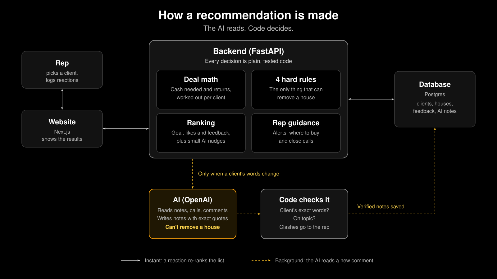

# STR Search: client deal recommendations

Fewer, better-fit deals per client, with reasons, and help for clients unsure where to buy.



## Run it
```bash
docker compose up                    # http://localhost:3000 (API docs: :8000/docs)
docker compose run --rm api pytest   # 95 tests, against a throwaway local database
```
No `.env` needed: compose runs its own Postgres and the AI's saved notes ship as a migration. Optional (`.env.example`): `DATABASE_URL` for Supabase; `OPENAI_API_KEY` to read new comments and run the evals.

## How recommendations work, and why
**Part A is arithmetic.** Deal numbers are per client. Four hard rules exclude a deal: over budget (+10% if flexible), avoided market, too few bedrooms, doesn't pencil. The rest are ranked, the client's named markets first, by a score whose parts are the explanation lines:

- **Main focus, 70%** (30% for lifestyle): downside-weighted CoC, tax saved per dollar, equity growth, or break-even.
- **Preferences, 30%** (70% for lifestyle): market, setting, wow factors, renovation, turnkey.
- **Feedback:** a reacted deal moves to "Already shared"; similar deals rise or fall.

**Part B reads what clients say.** C-03 said "Not interested in mountain cabins" and still got a Poconos house first. An LLM turns notes, calls and comments into **signals** from a closed list; code decides what they mean:

- **Every signal quotes the client word for word** and must be on topic, or it is dropped.
- **Signals nudge, never exclude.** Contradictions become "confirm with the client" alerts.
- **Alerts:** client questions, C-13's 1031 deadline, budget vs stated range, a 0% co-host fee.
- **Where to buy:** 14 markets ranked for each client; shown first to undecided clients (C-12).
- **Close calls:** a deal out only on money shows the highest price that passes (within 5%).

Why: a rep must defend every deal to someone spending $200K+, so arithmetic decides and the LLM only reads. C-03 now gets Bradenton first.

## What I researched, and what changed
- **"STR loophole"** ([CBIZ](https://www.cbiz.com/insights/article/short-term-rental-tax-strategy-unlocking-tax-savings), [JofA](https://www.journalofaccountancy.com/issues/2000/jan/shorttermrentalsclassifiedaspassiveactivitylosses.html)): short stays plus active owners can offset W-2 income. **Changed:** C-09 uses a co-host, so their tax savings may not apply; it's a question below, not a rule.
- **Bonus depreciation** ([RSM](https://www.rsmus.com/insights/services/business-tax/obba-tax-bonus-depreciation)): back to 100% after Jan 19, 2025. **Changed:** the large year-1 tax numbers are plausible, so I rank on them as given.
- **1031** ([CBIZ](https://www.cbiz.com/insights/article/1031-exchange-deadlines-45-day-and-180-day-rules-explained)): 45 days to identify. **Changed:** C-13's deadline is an urgent alert, not a nudge.

## Assumptions
Debt service = monthly payment × 12 (an annual payment flips 9 decisions). `budget` beats `budget_range`; the conflict is flagged. Boundaries (10% over, 3% CoC, $0 cash flow) pass. No bedroom count, no recommendation. D-116/D-126 are one house. `seed.sql` is untouched. More in [`docs/DESIGN.md`](docs/DESIGN.md).

## What I'd ask STR Search before v2
1. Debt service: monthly × 12, or one annual payment?
2. When profile and call disagree (C-01 "under $320K"), which wins? Can reps override?
3. Does `est_year1_tax_savings` assume material participation, even for co-hosted clients (C-09)?
4. C-07 plans to use a co-host but entered 0%: check break-even with a co-host fee?
5. How many deals per batch? Can we get purchase outcomes to learn weights from?

## What I'd build next
Weights learned from logged reactions; drive time from home; rep confirm/reject on each signal.

## Where AI helped, and LLM cost
Claude Code helped with analysis, plans and first drafts, each read, run and rewritten before commit; its mistakes and the product LLM's are in [`docs/AI_LOG.md`](docs/AI_LOG.md). `gpt-5.4-mini` costs **≈ $0.003 per client**, measured, and re-runs only when a client's text changes. 20 eval cases pass 20/20 on two runs.
